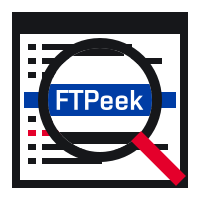
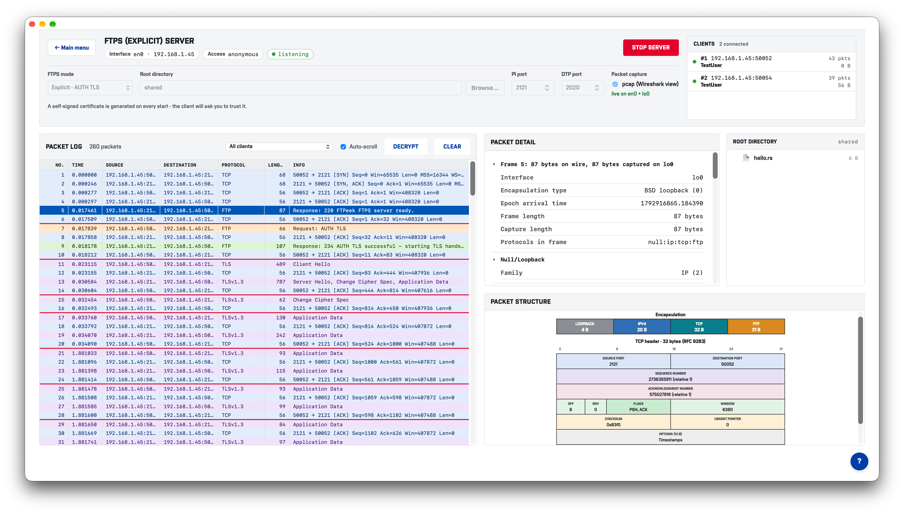

[](https://github.com/SimonVesely/bachelors_thesis/actions/workflows/build.yml)
[](https://simonvesely.github.io/bachelors_thesis/FTPeek/index.html)
[](https://github.com/SimonVesely/bachelors_thesis/releases)
[](LICENSE)
[](https://www.rust-lang.org/)
[](https://deps.rs/repo/github/SimonVesely/bachelors_thesis)

<p align="center">
  
</p>

# Protocol Analyzer — FTP / SFTP / FTPS / TFTP

**Application for analyzing the communication of file transfer protocols**

A server-side application for demonstrating and analyzing file-transfer
protocol communication. Built entirely in Rust.

## Graphical User Interface made with Dioxus
<p align="center">
  
</p>

## Scope

This repository is developed in two stages:

- **Semester project (current)** — **server only**, for all four protocols.
  Each server is standalone and interoperates with existing clients
  (FileZilla, curl, lftp, ...) —
  standards-compliant server whose communication can be logged and
  inspected in real time.
- **Bachelor's thesis** — extends this into a full client + server
  application, either as two independently runnable programs or as a single
  app with a split client/server view, so both sides of a session can be
  analyzed side by side.

## What it does (semester project)

On launch, the user picks which **protocol server** to run (FTP, SFTP, FTPS,
or TFTP) and a **port**. Any standard client can connect to it. Every command
and response exchanged with a connecting client — control-channel messages,
and, where relevant, the underlying binary/SSH packets — is displayed and
recorded, so the communication can be inspected and compared across
protocols.

## Supported protocols

| Protocol | Transport      | Implementation                    | Verified against       |
|----------|-----------------|-------------------------------------|--------------------------|
| FTP      | TCP, plaintext  | raw, hand-written                   | FileZilla, curl, lftp    |
| FTPS     | TCP + TLS       | FTP extension with `rustls` wrapper | FileZilla, lftp          |
| TFTP     | UDP             | raw, hand-written                   | `curl`                   |
| SFTP     | SSH2 subsystem  | built on `russh`                    | FileZilla                |

## Project layout

```
crates/
  proto-core/     shared message-log types + user database + capture of traffic
  proto-ftp/      FTP server
  proto-ftps/     FTP server over TLS
  proto-tftp/     TFTP server
  proto-sftp/     SFTP server
ftpeek/           Dioxus desktop application
```

## Documentation

You can build official Rust documentation using on your own machine:
```
cargo doc --workspace --no-deps --document-private-items --open
```
For official code documentation view: **[Github Pages Documentation for FTPeek](https://simonvesely.github.io/bachelors_thesis/FTPeek/index.html)**

## Building manually on your own machine

```
cargo build --workspace
cd ftpeek/
dx serve
```

## Running pre-build application

Refer to **[Release page](https://github.com/SimonVesely/bachelors_thesis/releases)**, download newest release for your Operating System

## Project dependencies

FTPeek is built in Rust and powered by the following open-source dependencies:

### Core & Framework
* **[Rust](https://www.rust-lang.org/)** (Edition 2024) — Core programming language (`MIT` / `Apache-2.0`)
* **[Tokio](https://tokio.rs/)** — Asynchronous runtime for Rust (`MIT`)

### Graphical User Interface
* **[Dioxus](https://dioxuslabs.com/)** — Fullstack app framework for web, desktop, and mobile made in Rust (`MIT` / `Apache-2.0`)

### Security & Protocol Libraries
* **[rustls](https://github.com/rustls/rustls)** & **[tokio-rustls](https://github.com/rustls/tokio-rustls)** — Modern TLS library and Tokio integration (`Apache-2.0` / `MIT` / `ISC`)
* **[russh](https://github.com/warp-tech/russh)** — Pure Rust SSH implementation (`Apache-2.0` / `MIT`)
* **[russh-sftp](https://github.com/warp-tech/russh)** — SFTP protocol support built on top of `russh` (`Apache-2.0` / `MIT`)
* **[rcgen](https://github.com/est31/rcgen)** — X.509 certificate generation library (`MIT` / `Apache-2.0`)

### Network Capture
* **[pcap](https://github.com/rust-pcap/pcap)** — Crate for accessing the packet sniffing capabilities of libpcap (or Npcap on Windows) (`Apache-2.0` / `MIT`)

### Utilities & Infrastructure
* **[Serde](https://serde.rs/)** — Serialization and deserialization framework (`MIT` / `Apache-2.0`)
* **[Tracing](https://github.com/tokio-rs/tracing)** & **[tracing-subscriber](https://github.com/tokio-rs/tracing)** — Application-level tracing and logging (`MIT`)
* **[Anyhow](https://github.com/dtolnay/anyhow)** & **[thiserror](https://github.com/dtolnay/thiserror)** — Flexible error handling (`MIT` / `Apache-2.0`)
* **[Bytes](https://github.com/tokio-rs/bytes)** — Robust byte buffer management (`MIT`)
* **[if-addrs](https://github.com/messense/if-addrs)** — System network interface discovery (`MIT` / `Apache-2.0`)
* **[directories](https://docs.rs/directories/6.0.0/directories/)** — Provides the platform-specific user-accesible locations (`MIT` / `Apache-2.0`)

### Local User Database
* **[redb](https://github.com/cberner/redb)** - Portable, high-performance, ACID, embedded key-value store database (`MIT` / `Apache-2.0`)
* **[argon2](https://docs.rs/argon2/latest/argon2/)** - Rust implementation of the Argon2 password hashing function (`MIT` / `Apache-2.0`)

---

## License

FTPeek — Application for analyzing the communication of file transfer protocols
Copyright (C) 2026 Simon Veselý

This program is free software: you can redistribute it and/or modify it under the terms of
the GNU General Public License as published by the Free Software Foundation, either version 3
of the License, or (at your option) any later version. See [LICENSE](LICENSE) for the full text.
